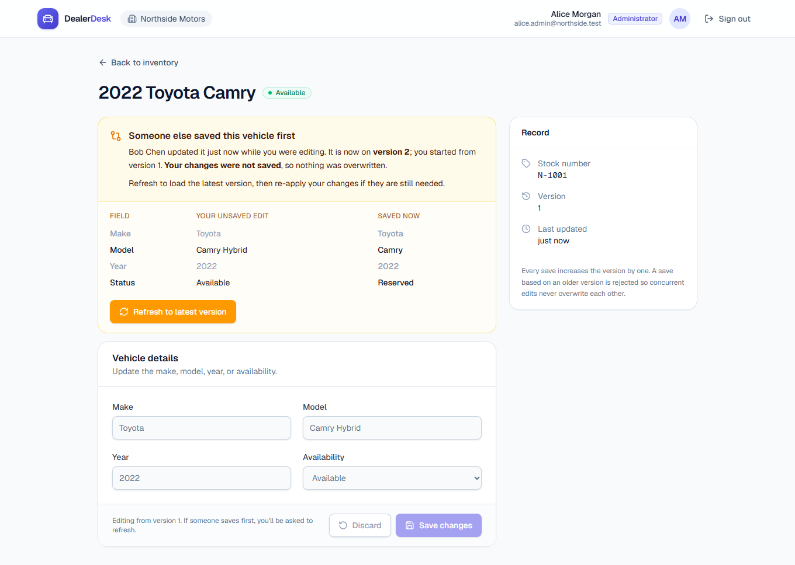

# DealerDesk: Dealership Inventory

A small full-stack app for two fictional dealerships to view and update their vehicle inventory.
Each user belongs to exactly one dealership and is either an **administrator** (can edit) or a
**viewer** (read-only). Two administrators can edit the same vehicle at the same time without
either change being silently lost.

**Stack:** Next.js 16 (static export) · FastAPI (Python 3.13) · PostgreSQL 16 · GitHub Actions ·
Cloudflare Workers (deployment built, waiting on account setup, see [status](#status)).

| | |
|---|---|
| Repository | https://github.com/aneeq178/dealership-inventory |
| Deployed app | _Pending: Cloudflare and Neon accounts must be set up first. See [Deployment](#deployment-cloudflare)._ |
| Loom walkthrough | _To be recorded._ |
| Lost-update demo, red run | [CI run 40089597027](https://github.com/aneeq178/dealership-inventory/actions/runs/40089597027) on `de5c4fc` |
| Lost-update demo, green run | [CI run 40089805129](https://github.com/aneeq178/dealership-inventory/actions/runs/40089805129) on `6dc1a40` |



---

## Status

Honest summary of what is done and verified versus still open.

| Requirement (assessment section) | Status | Evidence |
|---|---|---|
| Login, logout, scoped list, admin edit form; updates persist (4.1) | Done, verified | E2E `workflow.spec.ts` |
| Loading, invalid credentials, expiry/invalidation, forbidden, API failure states (4.1) | Done, verified | E2E `access.spec.ts`, manual review |
| Auth, role and dealership enforcement with direct API tests; rejected writes leave data unchanged (4.2) | Done, verified | `tests/test_auth.py`, `tests/test_access.py` |
| CI runs tests and build on PRs (4.3) | Done, verified | Actions tab, PRs #1 to #3 |
| Deploy to Cloudflare only after checks pass; secrets in GitHub (4.3) | Built; **not yet run** (needs accounts) | `deploy` job in `ci.yml`, [Deployment](#deployment-cloudflare) |
| Atomic lost-update prevention + regression test that fails on the defect (4.4) | Done, verified | Red and green runs above, `tests/test_concurrency.py` |
| Frontend explains conflict and asks to refresh (4.4) | Done, verified | E2E `conflict.spec.ts` |
| Repeatable seed: 2 dealerships, 6 users, 8 vehicles, hashed passwords (5) | Done, verified | `scripts/seed.py`, `scripts/reset.py` |
| Frontend E2E for login, inventory, allowed update (5) | Done, verified | 7 Playwright tests |
| Smoke test against the deployed app (5) | Wired into the deploy job; verified locally only so far | `scripts/smoke.py`, 15/15 against localhost |
| Health endpoint without secrets (6.1) | Done, verified | `GET /api/health`, `tests/test_health.py` |

---

## Reviewer accounts

All accounts are synthetic. One shared password: **`Dealer#2026`**. The login page also lists
them; click one to fill the form.

| Dealership | Name | Email | Role |
|---|---|---|---|
| Northside Motors | Alice Morgan | `alice.admin@northside.test` | admin |
| Northside Motors | Bob Chen | `bob.admin@northside.test` | admin |
| Northside Motors | Victor Reyes | `victor.viewer@northside.test` | viewer |
| Southgate Auto Group | Sara Patel | `sara.admin@southgate.test` | admin |
| Southgate Auto Group | Tom Walker | `tom.admin@southgate.test` | admin |
| Southgate Auto Group | Uma Brooks | `uma.viewer@southgate.test` | viewer |

Use **Alice and Bob** (or Sara and Tom) to reproduce the concurrent-edit conflict.

---

## Architecture

```
Browser ──► Next.js static files (HTML/JS/CSS)        Cloudflare static assets
   │
   └──► /api/*  FastAPI ──► PostgreSQL                 Python Worker ─► Hyperdrive ─► Neon
                 │
                 ├─ api/        routes + auth dependencies (current_user, require_admin)
                 ├─ services/   use cases (login, update with conflict handling)
                 ├─ repositories/ all SQL, every vehicle query scoped by dealership_id
                 ├─ schemas/    pydantic request/response models
                 └─ core/       config, db connection, errors, password + token security
```

In production the frontend and API are served from **one origin**, so there is no CORS and the
frontend calls relative `/api/...` URLs. Locally, `next dev` runs on :3000 and calls the API on
:8000 with CORS enabled for that origin only.

```
backend/
  app/                FastAPI application (layers above)
  migrations/         forward-only SQL migrations (001_init.sql)
  scripts/            migrate, seed, reset, smoke
  tests/              pytest API tests against real Postgres
cloudflare/
  src/entry.py        Worker entrypoint: same FastAPI app, Worker-native DB + settings
  configure.py        renders wrangler.json and bundles backend/app at deploy time
  tests/              WebCrypto password hashing check under Pyodide
frontend/
  app/                pages: /login, /vehicles, /vehicles/edit?id=
  components/         UI primitives, app shell, auth provider, toasts
  lib/                api client, session storage, types, formatting
  e2e/                Playwright specs
.github/workflows/    ci.yml
docs/                 plan, decisions, work log, screenshots
```

Design decisions and tradeoffs are in [docs/DECISIONS.md](docs/DECISIONS.md).

---

## Local setup

**Prerequisites:** Docker, Python 3.12+ (CI uses 3.13), Node 20+.

```bash
# 1. Database (Postgres 16 on localhost:5432)
docker compose up -d

# 2. Backend
cd backend
python -m venv .venv
.venv/Scripts/pip install -r requirements-dev.txt   # macOS/Linux: .venv/bin/pip
cp .env.example .env
.venv/Scripts/python -m scripts.reset               # create DB, migrate, seed
.venv/Scripts/python -m uvicorn app.main:create_app --factory --reload --port 8000

# 3. Frontend (new terminal)
cd frontend
npm ci
npm run dev                                          # http://localhost:3000
```

### Environment variables

Names only; no real secrets are committed. See `backend/.env.example` and `frontend/.env.example`.

| Variable | Where | Purpose |
|---|---|---|
| `DATABASE_URL` | backend | Postgres connection string |
| `JWT_SECRET` | backend | HS256 signing key, at least 32 characters (enforced at startup) |
| `ACCESS_TOKEN_TTL_MINUTES` | backend | Session and token lifetime, default 30 |
| `PASSWORD_HASH_ITERATIONS` | backend | PBKDF2 iterations for new hashes, default 600000 |
| `CORS_ORIGINS` | backend | Allowed cross-origin frontends; empty in production |
| `APP_VERSION` | backend | Reported by `/api/health`; set to the git SHA on deploy |
| `STATIC_DIR` | backend | Optional: serve `frontend/out` from the API (E2E tests) |
| `TEST_DATABASE_URL` | tests | Test database, default `.../dealership_test` |
| `NEXT_PUBLIC_API_BASE_URL` | frontend | API origin; empty in production (same origin) |
| `NEXT_PUBLIC_SHOW_DEMO_ACCOUNTS` | frontend | Show demo accounts on the login page |

Deployment configuration is listed under [Deployment](#deployment-cloudflare).

### Database initialization and reset

| Command (from `backend/`) | What it does |
|---|---|
| `python -m scripts.migrate` | Applies pending files in `migrations/`, recorded in `schema_migrations`. Safe to re-run. |
| `python -m scripts.seed` | Truncates data tables and inserts the fixed seed rows (same UUIDs every time). |
| `python -m scripts.seed --if-empty` | Seeds only when no dealerships exist. Used by every deploy. |
| `python -m scripts.reset` | Creates the database if missing, drops all tables, migrates, seeds. Local and CI only. |

---

## Tests

| Command | What runs |
|---|---|
| `cd backend && .venv/Scripts/python -m pytest -v` | 54 tests: API, hashing, and the Worker entry wiring, against a real Postgres test database |
| `cd cloudflare && npm ci && npm run test:webcrypto` | Runs the Worker's WebCrypto password hashing under Pyodide and checks it against the RFC vector and Node's PBKDF2 |
| `cd backend && .venv/Scripts/ruff check . && .venv/Scripts/mypy` | Lint and type check |
| `cd frontend && npm run lint && npm run typecheck && npm run build` | Lint, type check, static build |
| `cd frontend && npm run test:e2e` | Builds the frontend, then 7 Playwright tests against the real stack |
| `python backend/scripts/smoke.py <base-url>` | 15 smoke checks against a running server; reverts its changes |

Tests use their own database (`dealership_test`, created automatically), so they never touch
development data. Each test reseeds, so tests are independent and repeatable.

### Coverage of the required scenarios

| Scenario | Test |
|---|---|
| Valid and invalid login | `test_auth.py::test_login_valid_returns_token_and_user`, `::test_login_wrong_password_rejected`, `::test_login_unknown_email_gets_same_error` |
| Missing, garbage, forged and expired token | `test_auth.py::test_missing_token_rejected`, `::test_garbage_token_rejected`, `::test_token_signed_with_other_secret_rejected`, `::test_expired_jwt_rejected` |
| Session expiry and invalidation (logout) | `test_auth.py::test_expired_session_rejected`, `::test_logout_revokes_token`, `::test_logout_only_revokes_that_session` |
| Admin update persists | `test_vehicles.py::test_admin_update_persists_and_bumps_version` |
| Viewer edit rejected, data unchanged | `test_access.py::test_viewer_cannot_update` |
| Cross-dealership read and update rejected, data unchanged | `test_access.py::test_cannot_read_other_dealership_vehicle`, `::test_cannot_update_other_dealership_vehicle` |
| Every protected route requires auth | `test_access.py::test_protected_routes_require_auth` (5 routes) |
| Client cannot move a vehicle to another dealership | `test_access.py::test_body_cannot_smuggle_dealership_id` |
| Invalid input rejected, data unchanged | `test_vehicles.py::test_invalid_input_rejected_and_data_unchanged` (8 cases) |
| Competing edits from the same version | `test_concurrency.py::test_competing_edits_from_same_version_exactly_one_wins` |
| Frontend: login, inventory, allowed update, reload, logout | `e2e/workflow.spec.ts` |
| Frontend: conflict shown, refresh required, retry succeeds | `e2e/conflict.spec.ts` |
| Frontend: viewer read-only, cross-dealership URL, invalid and revoked sessions | `e2e/access.spec.ts` |

### Latest local results

```
backend   pytest      54 passed
worker    pyodide     WebCrypto PBKDF2 matches RFC 7914 and node:crypto
backend   ruff, mypy  clean
frontend  eslint, tsc, next build  clean
e2e       playwright  7 passed (3 consecutive runs)
smoke     localhost   15/15 checks passed
```

---

## Access control

Every protected request passes three checks, all on the backend:

1. **Authenticated.** `current_user` (`backend/app/api/deps.py`) requires a bearer token,
   verifies the JWT signature and `exp`, then loads the session row. Missing, invalid, expired
   or revoked tokens get 401 with a specific error code.
2. **Role.** `require_admin` returns 403 for viewers before any SQL runs.
3. **Dealership scope.** Every vehicle query includes `AND dealership_id = $n` in SQL, taking
   the value from the authenticated user's database row. Another dealership's vehicle returns
   **404**, identical to a vehicle that does not exist, so its existence is not revealed.

Role and dealership are read from the database on every request, never from the request body
or URL. Request bodies reject unknown fields, so a client cannot even send `dealership_id`.

## Authentication, expiry and logout

- **Login** checks a PBKDF2-SHA256 hash (random salt; 600,000 iterations locally, fewer on
  Cloudflare, see [Deployment](#deployment-cloudflare)), creates a `sessions`
  row, and returns a 30-minute HS256 JWT containing the user id and session id. Wrong email and
  wrong password return the same error and take the same time.
- **Each request** verifies the JWT, then requires the session to exist, be unrevoked and
  unexpired. Expiry is enforced twice: by the JWT `exp` and by `sessions.expires_at`.
- **Logout** sets `sessions.revoked_at`. The same token is rejected immediately, even though its
  JWT has not expired. This is tested.
- **Frontend.** The token lives in `sessionStorage` (per tab). Any 401 clears it and returns
  the user to `/login` with a reason, such as "Your session expired".

## Concurrency: preventing lost updates

Clients send the `version` they loaded with every update. The repository applies the update in
**one statement** (`backend/app/repositories/vehicles.py`):

```sql
UPDATE vehicles
   SET make = $1, model = $2, year = $3, status = $4,
       version = version + 1, updated_at = now(), updated_by = $5
 WHERE id = $6 AND dealership_id = $7 AND version = $8
RETURNING ...
```

- One row updated: success, and the response carries the new version.
- Zero rows: the service re-reads the vehicle within the caller's dealership. If it exists, the
  response is **409** `version_conflict` with the current record. Otherwise it is **404**.

**Why it is atomic.** The version check is part of the write. When two such updates race,
Postgres row locking makes the second wait for the first to commit. The second then re-checks
its `WHERE` clause against the committed row, which is now on version N+1, so it matches nothing.
There is no window between "check" and "write".

### Regression demonstration

| Commit | Change | CI |
|---|---|---|
| `309eed5` | Original update: read the version, compare in Python, write unconditionally | Not tested for races yet |
| `de5c4fc` | Adds `tests/test_concurrency.py` | [Red](https://github.com/aneeq178/dealership-inventory/actions/runs/40089597027): 1 failed, 44 passed |
| `6dc1a40` | Atomic conditional `UPDATE` | [Green](https://github.com/aneeq178/dealership-inventory/actions/runs/40089805129): 45 passed |

The red run fails with:

```
AssertionError: expected exactly one success and one conflict, got [200, 200]: a stale edit was accepted (lost update)
```

**How the test exposes the defect every time.** Two admins submit different edits from version
1 concurrently. The defective code awaited a test hook between its read and its write. The test
puts a two-party barrier there, so both requests must read before either may write. Both see
version 1, both pass, both write: two 200 responses and a lost update. The fixed code has no
separate read, so the hook is never reached and the database decides. Locally the defective
version failed 25 of 25 runs and the fix passed 25 of 25.

**Reproduce locally:**

```bash
cd backend
git checkout de5c4fc -- app/repositories/vehicles.py     # defective version
.venv/Scripts/python -m pytest tests/test_concurrency.py  # 1 failed: got [200, 200]
git checkout HEAD -- app/repositories/vehicles.py         # fixed version
.venv/Scripts/python -m pytest tests/test_concurrency.py  # 2 passed
```

The defective variant was never deployed. The deploy job only runs after every check passes on
`main`, and the fix merged before any deployment existed.

### Reproducing the conflict in the UI

1. Open the app in two browser windows, or two tabs, since sessions are per tab.
2. Sign in as `alice.admin@northside.test` in one and `bob.admin@northside.test` in the other.
3. Both open **2022 Toyota Camry** and see version 1.
4. Alice changes the model and saves. She sees "Saved, now version 2".
5. Bob changes something else and saves. He sees **"Someone else saved this vehicle first"**,
   who changed it, a comparison of his edit against the saved values, and a
   **Refresh to latest version** button. Saving stays disabled until he refreshes.
6. After refreshing, Bob sees Alice's change, re-applies his own, and saves as version 3.

`e2e/conflict.spec.ts` automates exactly these steps.

---

## CI/CD

`.github/workflows/ci.yml` runs **automatically** on every pull request and every push to
`main`, and **manually** from the Actions tab (CI/CD, then Run workflow).

| Job | Steps | Depends on |
|---|---|---|
| Backend | ruff, mypy, migrate and seed an empty DB, pytest against a Postgres service | none |
| Frontend | eslint, tsc, static build | none |
| Worker | WebCrypto hashing under Pyodide, lint, render a test Wrangler config | none |
| E2E | Build frontend, start API serving it, Playwright against a Postgres service | Backend, Frontend |
| Deploy | Build, migrate, seed if empty, deploy Worker, set secret, wait for health, smoke test | **all four above** |

**Gating.** The deploy job lists every check under `needs`, so any failing check means it never
starts. It runs only for `main`: on a push, or on a manual run with "deploy" ticked. Pull
requests never deploy. Superseded pull-request runs are cancelled; runs on `main` never are.

**Manual run options:**

| Input | Effect |
|---|---|
| `ref` | Commit, branch or tag to test and deploy. Empty means the selected branch. An older SHA rolls back. |
| `deploy` | Deploy after checks pass. Only applies on `main`. |
| `reset_demo_data` | Reset accounts and vehicles to the seed state. Wipes edits. Never happens automatically. |

---

## Deployment (Cloudflare)

One Cloudflare Worker serves everything on its free `workers.dev` URL:

| Part | How |
|---|---|
| Frontend | `frontend/out` uploaded as static assets. Pages never run Python and cost no Worker CPU. |
| API | The same FastAPI app on Cloudflare Python Workers. Only `/api/*` reaches it (`run_worker_first`). |
| Database | Neon Postgres (free tier) through Cloudflare Hyperdrive, one asyncpg connection per request |
| Settings | Read from the Worker's `env`: `JWT_SECRET` is a Worker secret; other values are Wrangler vars |
| Entry point | `cloudflare/src/entry.py` swaps the DB and settings dependencies. No business code changes. |

### Configuration

Values live in GitHub, never in the repository:

| Name | Kind | Value |
|---|---|---|
| `CLOUDFLARE_API_TOKEN` | Secret | API token from the "Edit Cloudflare Workers" template |
| `CLOUDFLARE_ACCOUNT_ID` | Secret | Cloudflare account ID |
| `DATABASE_URL` | Secret | Neon direct connection string, used by CI for migrations and seeding |
| `JWT_SECRET` | Secret | Random, at least 32 characters. CI pushes it to the Worker as a secret. |
| `HYPERDRIVE_ID` | Variable | ID of the Hyperdrive config pointing at Neon (not secret) |
| `PASSWORD_HASH_ITERATIONS` | Variable | Optional, default 10000. See the CPU budget below. |
| `APP_URL` | Variable | Optional fallback if the deploy log does not show the URL |

If anything required is missing, the deploy job fails at its first step and names what is missing.

### Free plan CPU budget and password hashing

The Workers free plan allows **10 ms of CPU per request**. Waiting on the database does not count.

- On Cloudflare, password checks use the runtime's native WebCrypto PBKDF2 instead of Python
  code compiled to WebAssembly. Both give identical results, which CI checks under Pyodide.
- Native PBKDF2-SHA256 measured about 0.6 µs per iteration on the development machine. 600,000
  iterations would cost about 370 ms, so the deployed seed uses **10,000 iterations** by
  default, about 6 ms. That is a deliberate, documented weakening forced by the free plan.
- Each stored hash records its own iteration count. Raising `PASSWORD_HASH_ITERATIONS` and
  rerunning with `reset_demo_data` rehashes the demo accounts. No code change is needed.

### Health verification

After deploying, the job polls `GET /api/health` until it reports `"db":"ok"` and the new git
SHA as `version`. Then it runs `backend/scripts/smoke.py` against the live URL. A failure in
either step fails the run.

### Release recovery

1. **Roll back code.** Run the workflow manually on `main` with `ref` set to the last good SHA.
   That commit is checked, then deployed. For an immediate rollback without rebuilding, run
   `npx wrangler rollback` from `cloudflare/` to restore the previous Worker version.
2. **Verify.** Check that `/api/health` reports the expected `version`, then run the smoke script.
3. **Database limitation.** Migrations are forward-only, and rolling back code does not roll
   back the schema. This is safe while migrations are additive: new tables and nullable
   columns. A destructive change, such as dropping or renaming a column, must be split across
   two releases: first add and backfill, then switch the code over, and only then drop. That
   way the previous release keeps working against the newer schema. Data written by a bad
   release is not undone automatically. Neon's point-in-time restore is the last resort.

---

## Known limitations

- **Not deployed yet.** The deploy job is built but has not run. It needs the Cloudflare and
  Neon accounts. Nothing about the live behaviour is verified until then.
- **Weaker password hashing on Cloudflare.** The free plan's 10 ms CPU budget forces far fewer
  PBKDF2 iterations than the 600,000 used locally. Each hash still has a random salt, and the
  stored iteration count lets it be raised on a paid plan.
- **Worker CPU time per request is unmeasured** until the first deploy.
- **No live rollback rehearsal.** Release recovery is documented but untested.
- **Token in `sessionStorage`.** Readable by JavaScript, so an XSS bug could steal it. An
  httpOnly cookie would avoid that but needs CSRF protection. With static files and a strict
  React render path, the XSS surface is small. Tradeoff explained in DECISIONS.md.
- **Single shared seed password** for all demo accounts, by design for reviewers.
- **No rate limiting** on login.
- **Static export** means no server-side rendering. Every page fetches data in the browser.
- **Test hook.** The defective update used a test-only hook. The fixed code has no hook, so
  this does not affect production.
