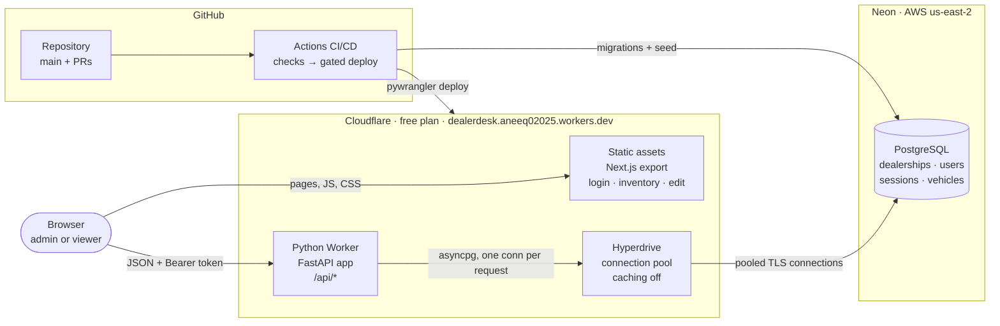
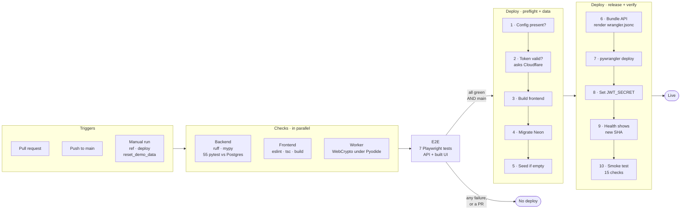
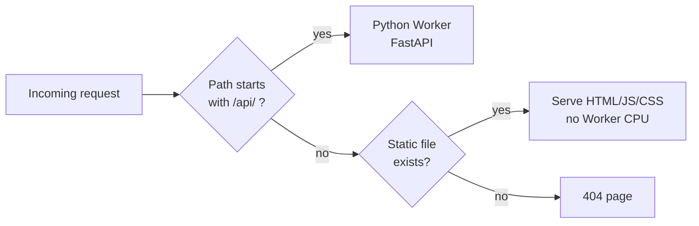
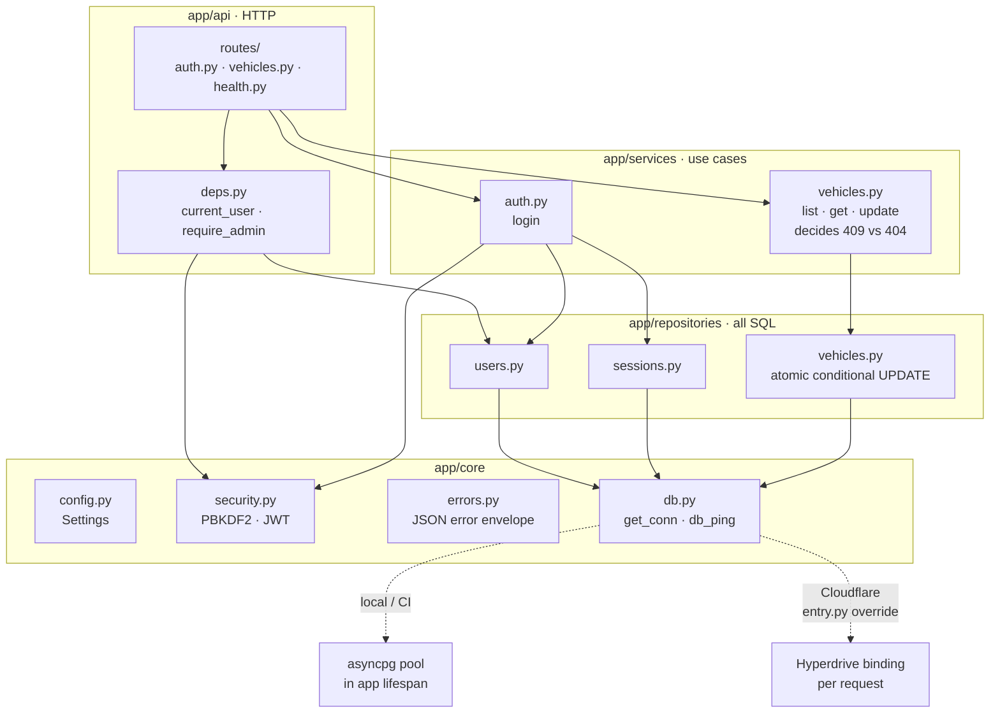
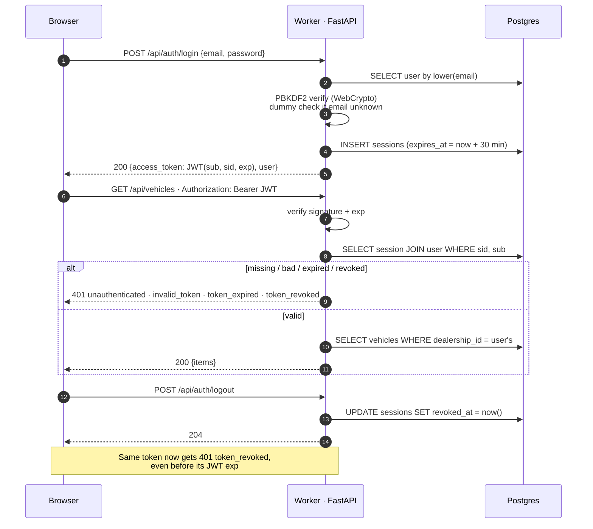
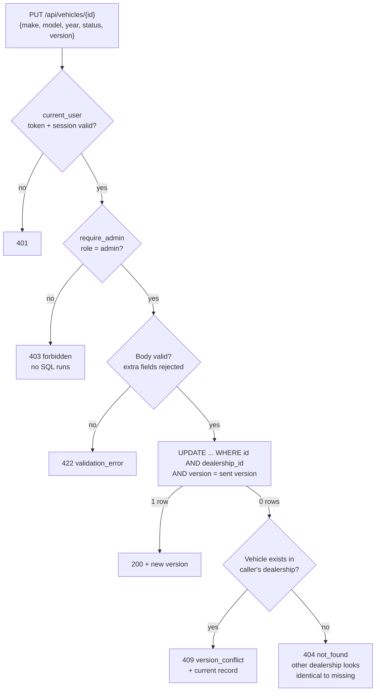
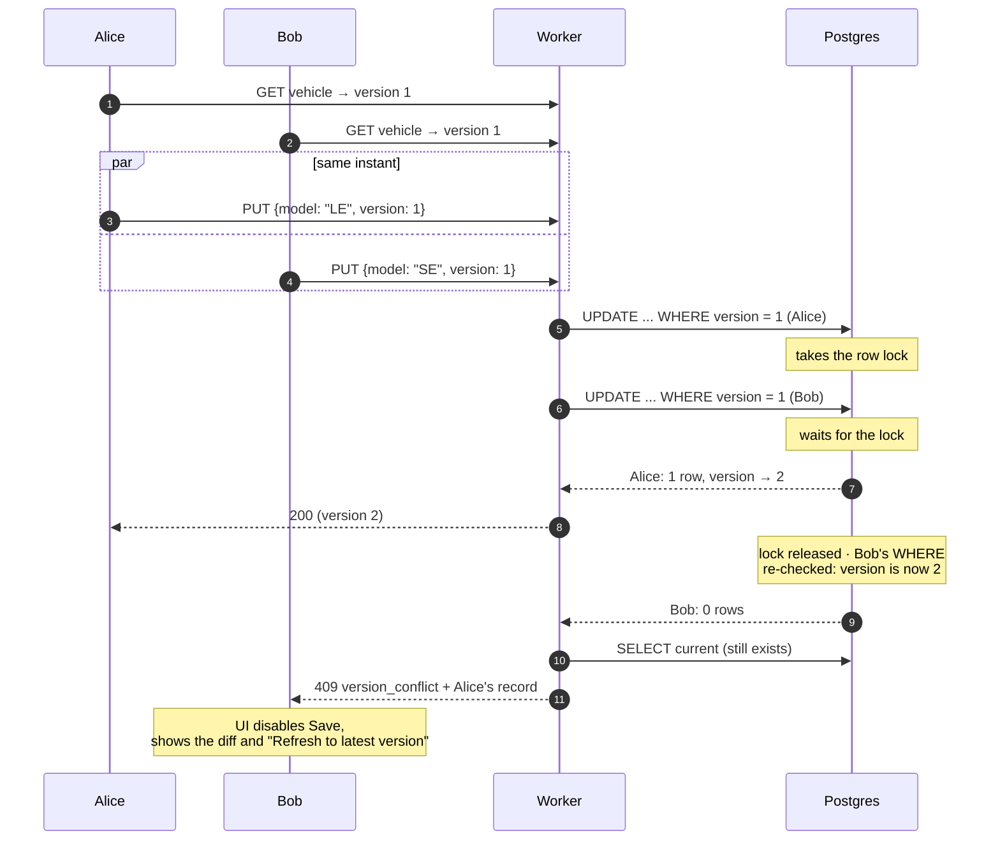
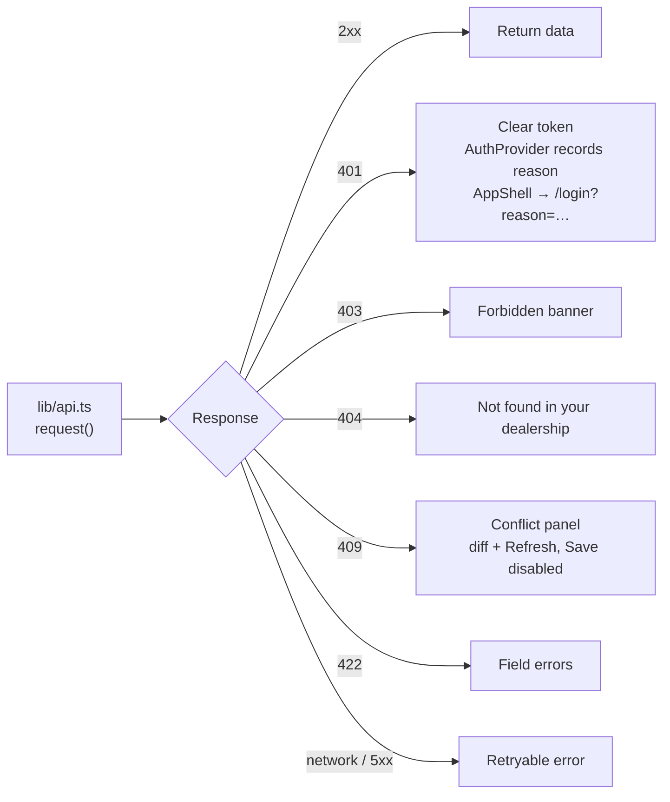
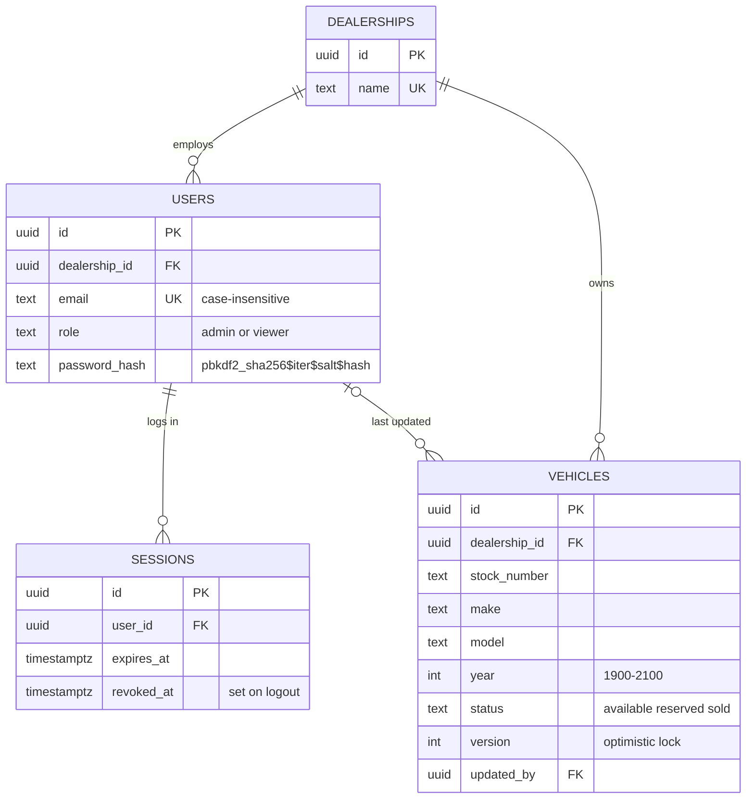

# Architecture

High-level views first, then the low-level request, auth, concurrency and data views.
Diagrams are Mermaid, so GitHub renders them in place. PNG copies for slides or video are in
[docs/diagrams/](diagrams/).

---

## High level

### 1. System overview

One origin serves both the pages and the API, so the browser never makes a cross-origin
call. Only `/api/*` runs Python; every page is a static file.

### 2. Delivery pipeline

Every step fails the job on error, and the steps that can fail cheaply (configuration,
token) run before the first one that changes anything (migration).

### 3. Request routing at the edge

---

## Low level

### 4. Backend layers

`cloudflare/src/entry.py` reuses this app unchanged and overrides three dependencies:
`get_conn`, `db_ping`, and `get_settings`.

### 5. Login, authenticated request, logout

### 6. Authorization decision for an update

Dealership and role always come from the session's database row, never from the request.

### 7. Two admins save the same version at once

The check and the write are one statement, so there is no gap between them. The defective
version (`309eed5`) read the version, compared it in Python, then wrote unconditionally. Both
requests passed the check and both wrote.

### 8. Frontend failure handling

### 9. Data model

