# DealerDesk System Design

**High-level and low-level design of the dealership inventory application**

Live: https://dealerdesk.aneeq02025.workers.dev · Repository: https://github.com/aneeq178/dealership-inventory

This document is the source of the PDF `docs/DealerDesk-System-Design.pdf`, which is built
by `docs/tools/build_design_pdf.cjs`. PNG copies of every figure, for slides and video, are
in [docs/diagrams/](diagrams/).

---

## How to read this document

### What high-level design means

**High-level design (HLD)** describes the system from the outside. It answers:

- **What are the major parts?** For example: a web frontend, an API, a database, a delivery pipeline.
- **Where does each part run?** For example: Cloudflare, Neon, GitHub.
- **How do the parts talk to each other?** Which protocols, and in which direction.
- **Who uses the system, and for what?**

HLD deliberately leaves out function names, SQL and field types. Its audience is anyone who
needs the big picture: reviewers, stakeholders, a new team member on day one.

### What low-level design means

**Low-level design (LLD)** opens each box from the HLD and describes how it works inside. It
answers:

- **How is the code organised?** Modules, layers, and their responsibilities.
- **Exactly what happens, step by step,** when a request arrives: every check, every
  decision, every database call.
- **What are the data structures?** Tables, columns, constraints, API contracts and error codes.
- **How are the hard cases handled?** Invalid tokens, wrong roles, other dealerships'
  data, two people saving at once.

Its audience is the engineers who build, review and maintain the code.

| | High-level design | Low-level design |
|---|---|---|
| Question | What are the parts and how do they connect? | How does each part work inside? |
| Detail | Systems, services, hosting, data flow | Modules, functions, SQL, fields, error codes |
| Typical diagrams | Context, deployment, user journey, pipeline | Flowcharts of logic, sequence diagrams, ERD, API tables |
| Changes when | The architecture changes | The code changes |
| In this document | Part 1, figures 1–6 | Part 2, figures 7–15 |

### Flowchart symbols

Flowcharts use the standard symbols (ISO 5807 / ANSI style), colour-coded for readability.

#### Figure 1 · Flowchart symbol legend

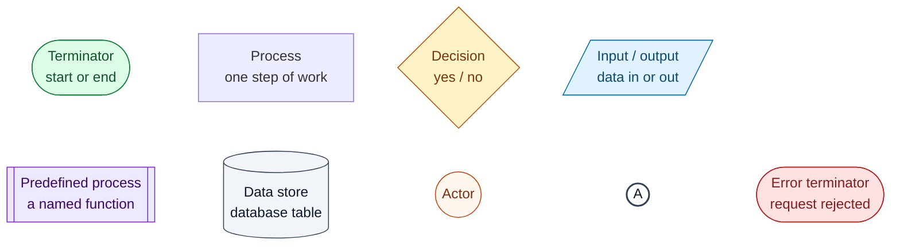

| Symbol | Shape | Meaning |
|---|---|---|
| Terminator | Rounded oval | Where a flow starts or ends. Red ovals end a flow with an error response. |
| Process | Rectangle | One step of work |
| Decision | Diamond | A yes/no question; each exit is labelled |
| Input / output | Parallelogram | Data entering or leaving: user input, an HTTP response |
| Predefined process | Rectangle with double sides | A named function described elsewhere |
| Data store | Cylinder | A database read or write |
| Actor | Circle with a name | A person or external system |
| On-page connector | Circle with a letter | The flow continues at the circle with the same letter. Long flowcharts are split into numbered columns this way. |

---

## Part 1 · High-level design

### 1.1 System context

Who uses DealerDesk, and which outside systems it depends on.

#### Figure 2 · System context

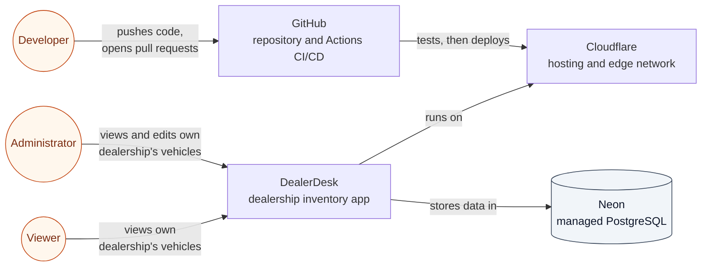

Two dealerships, Northside Motors and Southgate Auto Group, each have two administrators and
one viewer. Every user belongs to exactly one dealership and only ever sees that
dealership's vehicles.

### 1.2 Deployment architecture

Where each part runs in production, and what flows between them.

#### Figure 3 · Deployment architecture

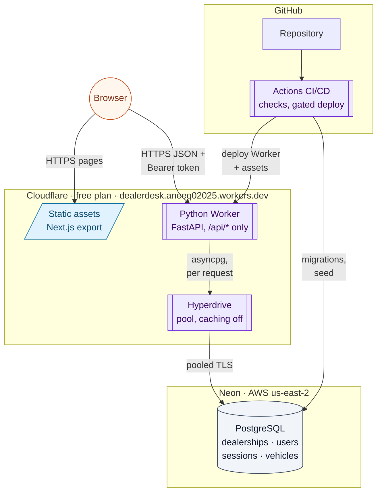

| Part | Technology | Why |
|---|---|---|
| Frontend | Next.js 16, static export, Tailwind | All data is per-user and fetched with a token, so plain files suffice and cost no compute |
| API | FastAPI on Cloudflare Python Workers | Python backend required; Cloudflare hosting required |
| Database | PostgreSQL 16 on Neon, through Hyperdrive | Row locking makes the atomic update correct; Hyperdrive pools connections near Neon |
| Delivery | GitHub Actions | Tests on every pull request; deploys only from a green `main` |

### 1.3 Request routing at the edge

Every request reaches Cloudflare first. Only API calls run Python.

#### Figure 4 · Request routing

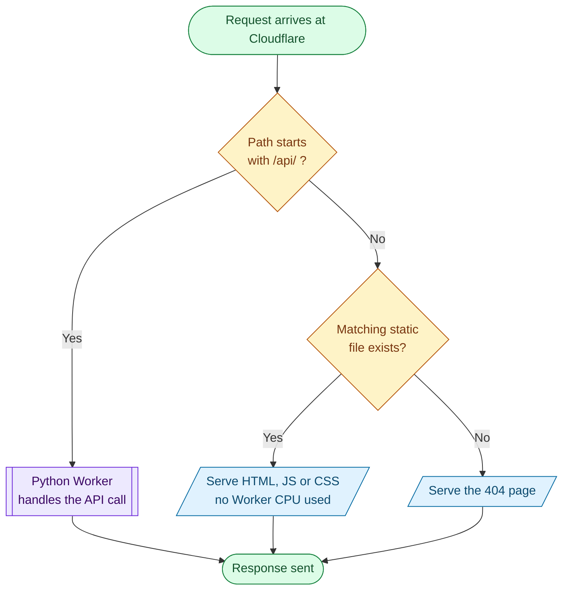

### 1.4 Main user journey

The business flow from the user's point of view.

#### Figure 5 · User journey

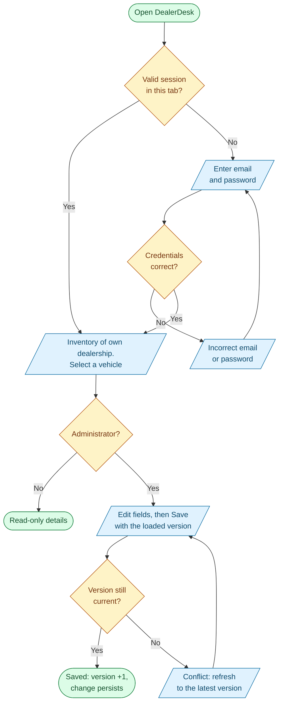

### 1.5 Delivery pipeline

From a code change to a verified release. Each failure stops the run before anything
further changes.

#### Figure 6 · CI/CD pipeline

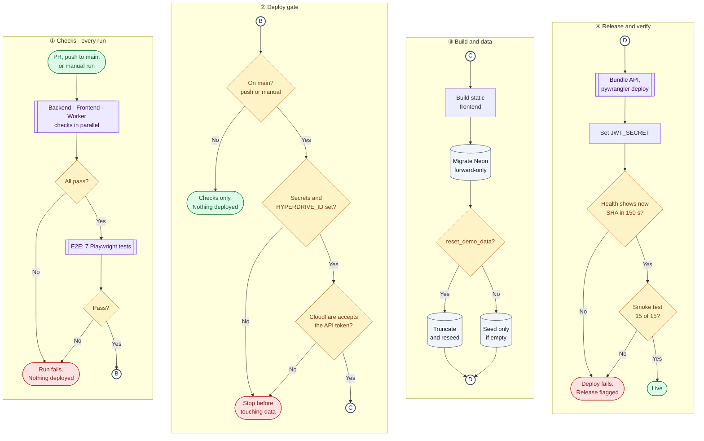

**Release recovery.** Rerun the workflow manually on `main` with `ref` set to the last good
commit, or run `wrangler rollback`. Migrations are forward-only, so a code rollback never
needs a schema rollback while migrations stay additive.

---

## Part 2 · Low-level design

### 2.1 Backend module structure

The FastAPI application is layered. Each layer depends only on the layers below it.

#### Figure 7 · Backend layers

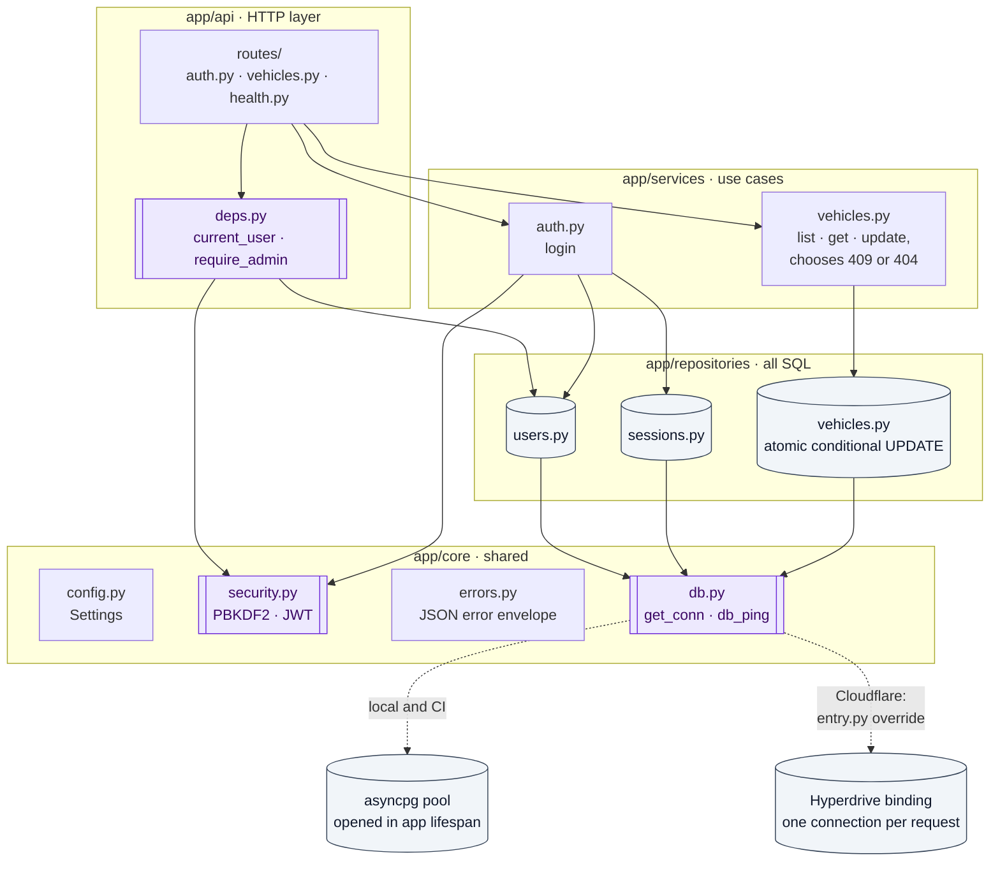

| Layer | Responsibility | Rule |
|---|---|---|
| `api/routes` | Parse input, pick the auth dependency, call a service | No SQL, no business rules |
| `api/deps.py` | Authenticate and authorize every protected request | Role and dealership come from the database, never the request |
| `services` | Use-case logic such as choosing 409 vs 404 | No HTTP details |
| `repositories` | Every SQL statement | Every vehicle query is scoped by `dealership_id` |
| `core` | Settings, connections, hashing, tokens, error format | No imports from layers above |

On Cloudflare, `cloudflare/src/entry.py` builds this same app and overrides three FastAPI
dependencies: `get_conn` and `db_ping` use the Hyperdrive binding, and `get_settings` reads
the Worker's `env`.

### 2.2 Login

`POST /api/auth/login` in `services/auth.py`.

#### Figure 8 · Login flowchart

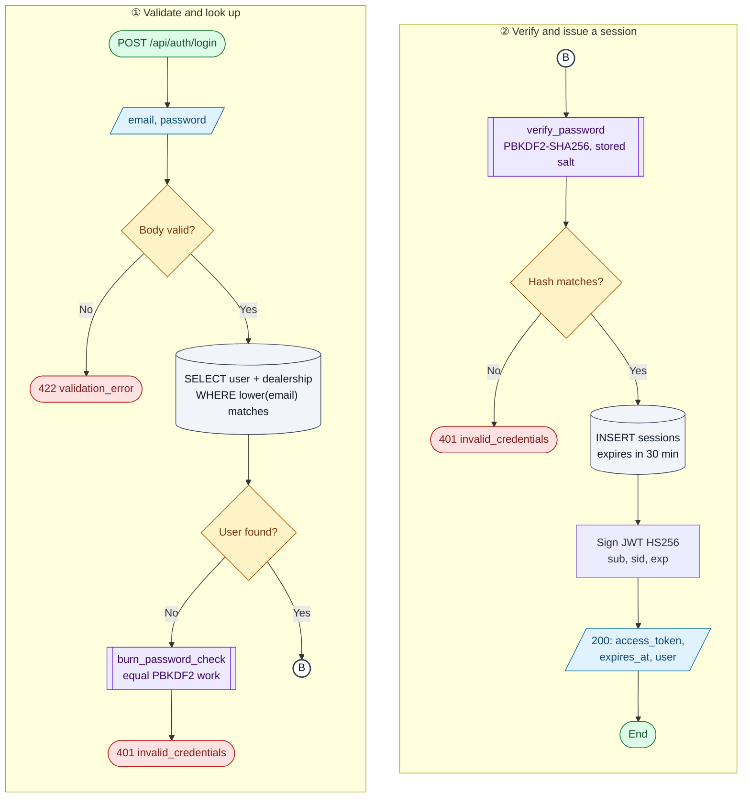

**Password storage.** `pbkdf2_sha256$<iterations>$<salt>$<hash>`, with a random 16-byte salt
per user. On Cloudflare the check runs through the runtime's native WebCrypto; locally it uses
`hashlib`. Both produce identical bytes, which is tested against the RFC 7914 vector.

### 2.3 Authenticating every protected request

`current_user` in `api/deps.py` runs before every protected endpoint.

#### Figure 9 · Token and session validation flowchart

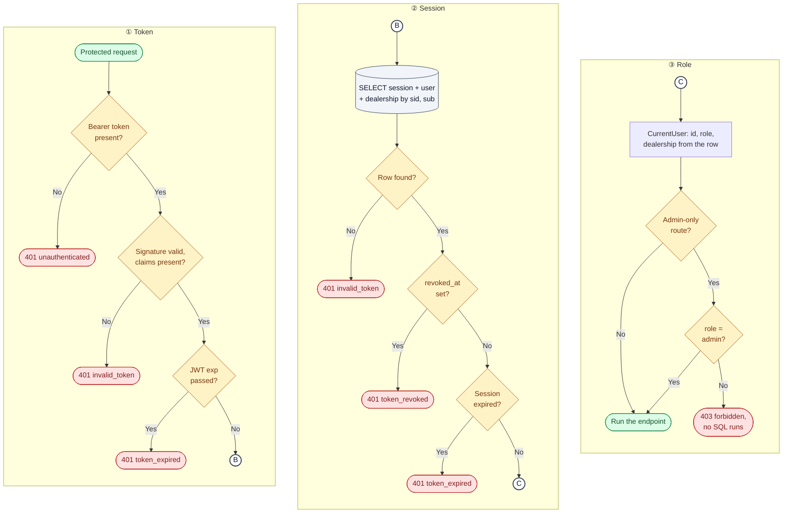

Read the columns left to right; each lettered circle continues at the matching circle in the
next column. **Expiry is enforced twice:** by the JWT `exp` claim and by `sessions.expires_at`.
**Logout** sets `sessions.revoked_at`, so the same token is refused immediately, even though
its JWT has not expired.

### 2.4 Updating a vehicle

`PUT /api/vehicles/{id}`, admin only. This is the core correctness path.

#### Figure 10 · Vehicle update flowchart

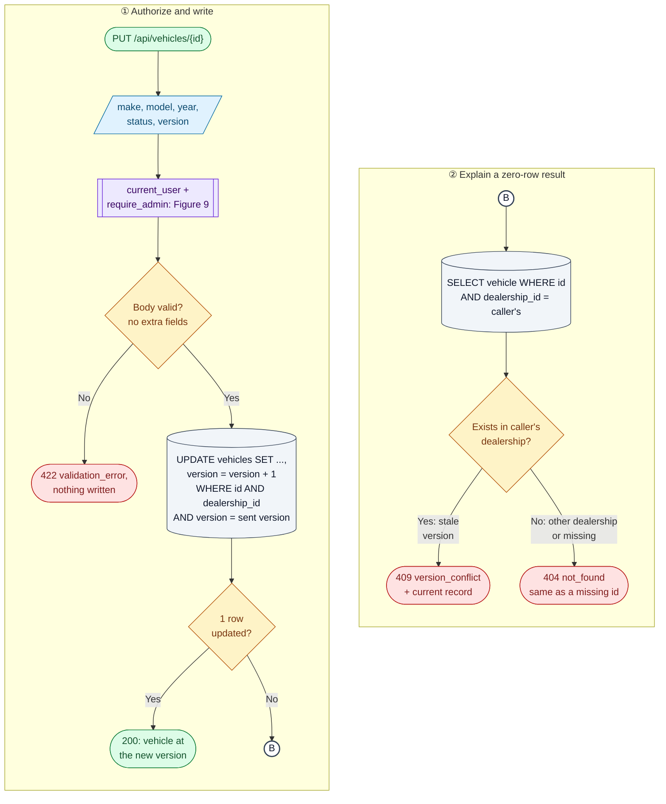

**Why the update is atomic.** The version check is inside the `UPDATE`'s `WHERE` clause, so
checking and writing are one statement with no gap between them. The defective version,
commit `309eed5`, read the version first, compared it in Python, then wrote unconditionally.
Two requests could both pass the comparison and both write.

### 2.5 Two administrators saving at once

#### Figure 11 · Concurrent update sequence

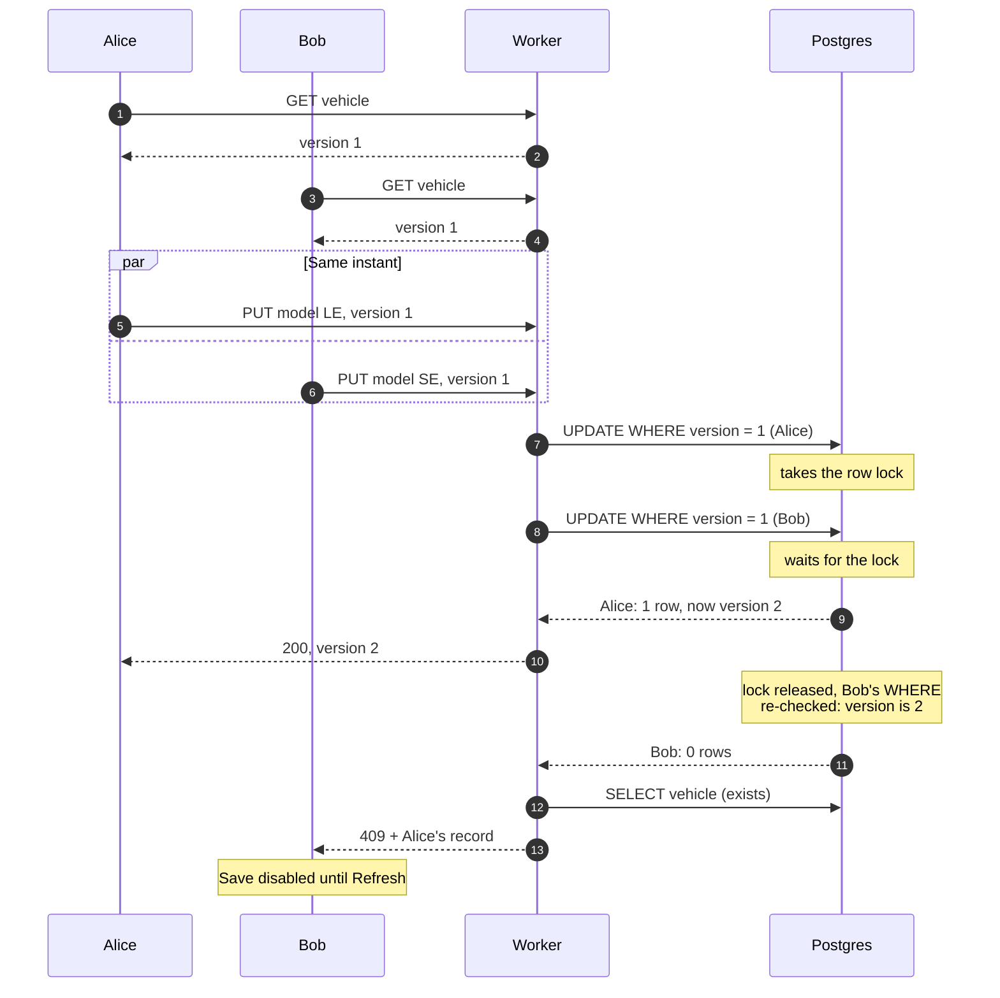

Verified three ways:

| Evidence | Result |
|---|---|
| `tests/test_concurrency.py`, with a barrier forcing the race | Fails on the defective code (`[200, 200]`), passes on the fix |
| CI | [Red run](https://github.com/aneeq178/dealership-inventory/actions/runs/40089597027) on `de5c4fc`, [green run](https://github.com/aneeq178/dealership-inventory/actions/runs/40089805129) on `6dc1a40` |
| `scripts/live_race.py` against production | 5/5 rounds of truly simultaneous saves, each with exactly one 200 and one 409 |

### 2.6 Request lifecycle across the stack

#### Figure 12 · Login, authenticated call and logout across the stack

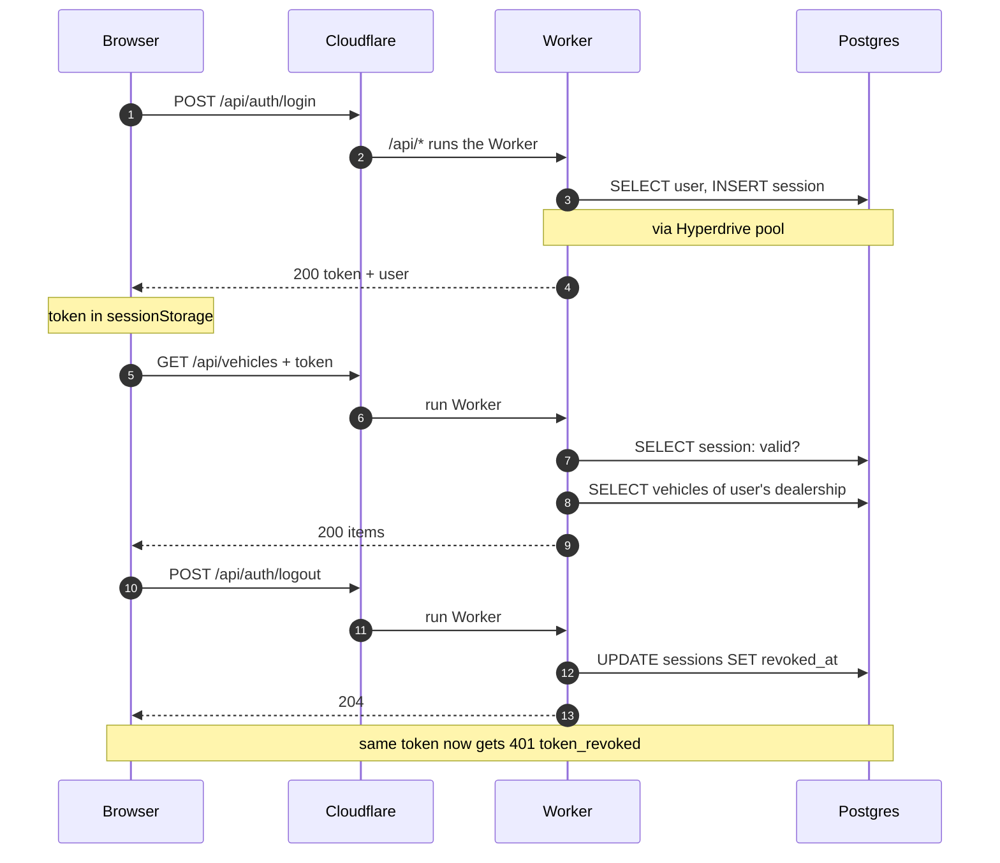

### 2.7 Frontend: the edit page

`frontend/app/vehicles/edit/page.tsx`, with all API errors mapped centrally in `lib/api.ts`.
A 401 at any point signs the user out and returns them to the login page with the reason.

#### Figure 13 · Edit page flowchart

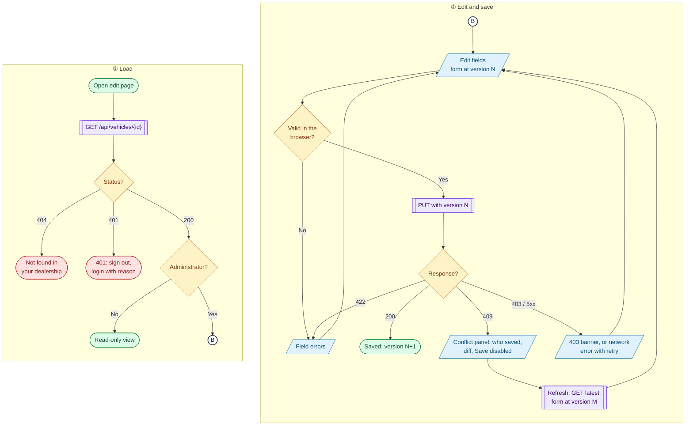

### 2.8 Data model

#### Figure 14 · Entity relationship diagram

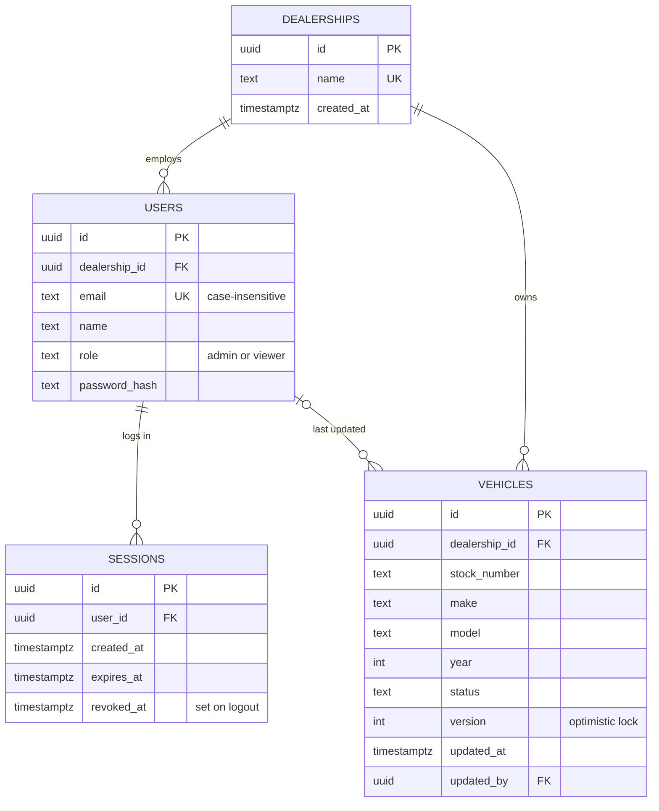

| Table | Key constraints |
|---|---|
| `dealerships` | `name` unique |
| `users` | `dealership_id` NOT NULL FK (exactly one dealership); unique `lower(email)`; `role` in (`admin`, `viewer`) |
| `sessions` | FK to user, cascades on delete; `revoked_at` null until logout |
| `vehicles` | `dealership_id` NOT NULL FK; `year` 1900–2100; `status` in (`available`, `reserved`, `sold`); make and model 1–50 chars; `version` ≥ 1; `(dealership_id, stock_number)` unique; index on `dealership_id` |
| `schema_migrations` | One row per applied migration file |

### 2.9 API contract

| Method and path | Who | Success | Errors |
|---|---|---|---|
| `POST /api/auth/login` | Anyone | 200 token + user | 401 `invalid_credentials`, 422 |
| `POST /api/auth/logout` | Signed in | 204 | 401 |
| `GET /api/auth/me` | Signed in | 200 user + dealership | 401 |
| `GET /api/vehicles` | Signed in | 200 own dealership's vehicles | 401 |
| `GET /api/vehicles/{id}` | Signed in | 200 vehicle | 401, 404 |
| `PUT /api/vehicles/{id}` | Administrator | 200 vehicle, version + 1 | 401, 403, 404, 409, 422 |
| `GET /api/health` | Anyone | 200 `{status, db, version}` | 503 when the database is unreachable |

Every error uses one envelope, `{"error": {"code", "message", "details?"}}`, so the frontend
switches on `code`:

| Code | HTTP | Meaning |
|---|---|---|
| `unauthenticated` | 401 | No bearer token |
| `invalid_token` | 401 | Bad signature, malformed token, or unknown session |
| `token_expired` | 401 | JWT `exp` or session `expires_at` has passed |
| `token_revoked` | 401 | Session was logged out |
| `invalid_credentials` | 401 | Wrong email or password, indistinguishable |
| `forbidden` | 403 | Viewer attempted an administrator action |
| `not_found` | 404 | Missing, or belongs to another dealership |
| `version_conflict` | 409 | Stale `version`; `details.current` holds the saved record |
| `validation_error` | 422 | Invalid fields; `details.fields` lists them |

### 2.10 Cloudflare Worker internals

#### Figure 15 · Worker request handling

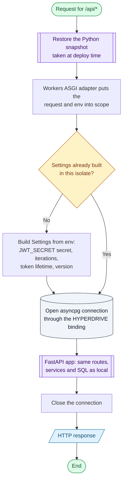

**Measured cost.** Cloudflare records `cpuTimeMs` per request. Medians run from 25 ms
(`GET /api/auth/me`) to 130 ms (login), above the free plan's documented 10 ms. All 45
measured requests were served. The floor is the Python-on-WebAssembly runtime, not the
application logic.
